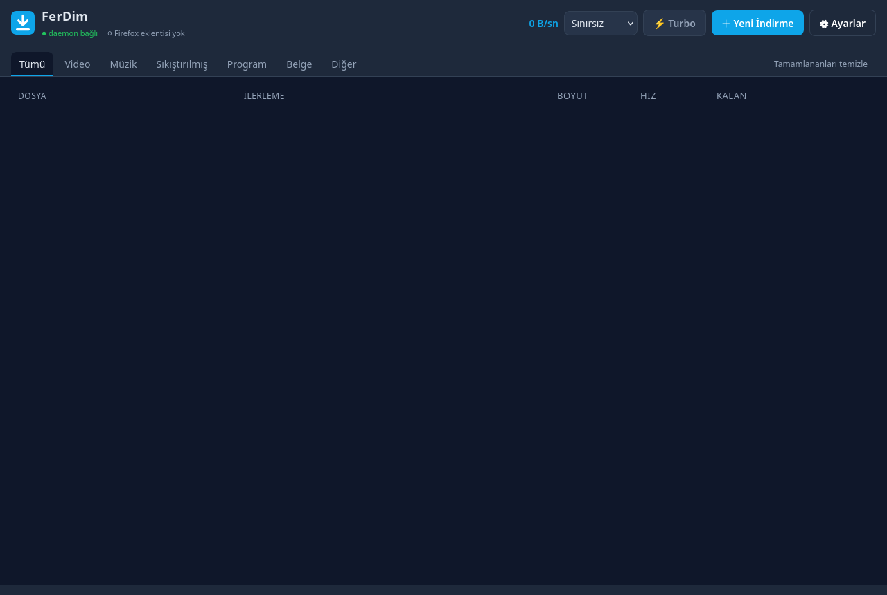
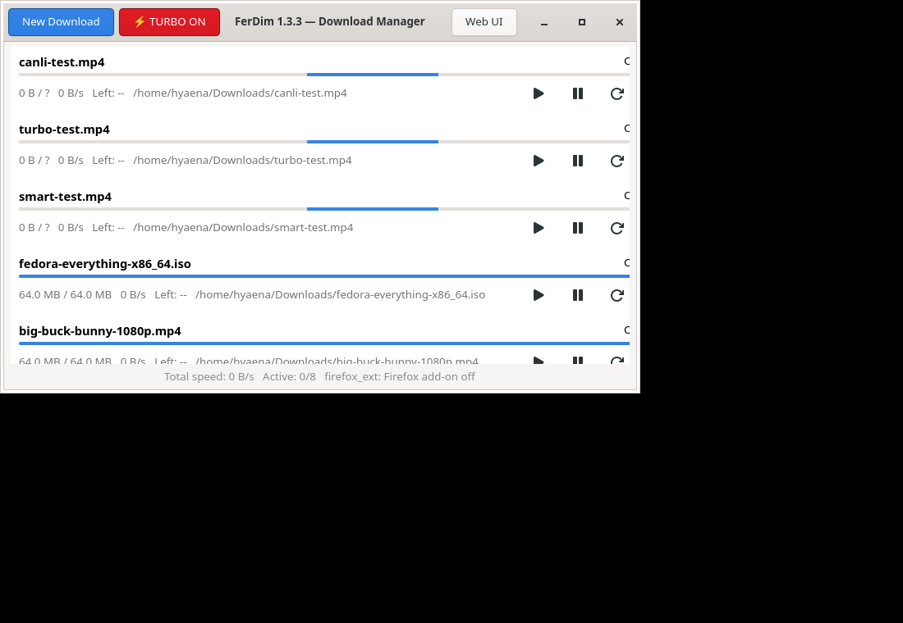

# FerDim

**A dynamic, self-tuning download manager for Linux — built Fedora-first, with native Firefox integration.**


FerDim saturates whatever ceiling is reachable — your line **or** the remote
server — and adapts continuously while a download runs. It is pure Python
(stdlib only for the engine), ships a Firefox WebExtension, and offers three
front-ends: CLI, web UI, and GTK 4.

```
┌──────────┐  native messaging   ┌────────────┐  Unix socket / HTTP   ┌────────────┐
│ Firefox  │◄───────────────────►│ ferdim-nm  │◄────────────────────►│  daemon    │
│ extension│  (4-byte + JSON)    │  (bridge)  │   (JSON-RPC)          │ (queue +   │
└──────────┘                     └────────────┘                       │  engine)   │
                                                                      └─────┬──────┘
   ┌────────────┐   ┌─────────────┐   ┌──────────────────┐                 │
   │ ferdim CLI │   │ ferdim-gui  │   │ Web UI           │◄────────────────┘
   └────────────┘   │ (GTK 4)     │   │ 127.0.0.1:8378   │   segmented, self-tuning
                    └─────────────┘   └──────────────────┘   engine (1–32 links)
```

| Web UI | GTK 4 app |
|:---:|:---:|
|  |  |

## Why it is fast — and smart

| Mechanism | What it does |
|---|---|
| **Throughput governor** | Measures aggregate speed every 2.5 s. Probes **+1 link** upward when speed keeps improving (servers that throttle per connection are scaled out this way); probes **downward** when speed is pinned at a ceiling, releasing redundant connections without losing throughput. Re-probes periodically as conditions change. |
| **Adaptive server limits** | HTTP `429/503`, connection resets or refusals while crowded → the pool halves (32 → 16 → … → 1), `Retry-After` is honored, remaining ranges are re-queued, and the job **never fails** because of throttling. The learned floor is remembered across resumes — but re-explored once the penalty window passes. |
| **Dynamic range sizing** | Each worker takes a bite sized to its measured throughput (~8 s of work, 256 KB – 32 MB): fewer reconnects on fast servers, more parallelism on slow ones. |
| **End-game donation** | Near the end of a file, workers holding large remainders donate tail ranges to parked workers, so the queue never collapses to a single connection. |
| **Parked worker pool** | Shrinking parks threads instead of killing them; the governor can re-arm them instantly. |
| **Crash-safe resume** | Sparse `.part` files in the target directory, metadata checkpointed every 2 s, `If-Range` (ETag / Last-Modified) validation; changed sources restart automatically. |
| **Big sockets** | Every connection requests a large `SO_RCVBUF` so the kernel keeps deep receive queues per link. |
| **HLS assembler** | Picks the best variant, fetches segments in parallel (1–8 workers), assembles in order, resumes per segment. |
| **DASH (MPD)** | Selects the best representation by resolution/bandwidth, resolves SegmentTemplate (`$Number$`/`$Time$`/SegmentTimeline) and SegmentList, then drives the same parallel-segment pipeline. |
| **Mirrors & metalink** | Repeatable `--mirror` URLs are blended round-robin into one job; `.metalink` / `.meta4` documents expand into queued files with preference-sorted mirrors and checksums. |
| **Integrity** | Optional per-job `--sha256` / `--md5` verification; a mismatch fails the job while keeping the data for inspection. |
| **Smart queue** | A background prober learns the size of queued files and runs smallest-first, so a 2 MB PDF never waits behind a 4 GB ISO. |

Also included: queue with concurrency limits and a night-window scheduler,
global + per-job speed limits, clipboard watching (event-driven on Wayland),
proxy and Basic-Auth support, custom headers/cookies/referer/UA passthrough
from the browser extension, ZIP preview from the queue view, and graceful
single-stream fallback for servers without byte ranges.

**Deliberate limits:** DRM-protected streams and live (non-VOD) HLS are not
downloaded; site-specific scraping is out of scope (generic media sniffing
only); `blob:` URLs are not reachable from outside the browser; no FTP.

## Installation

### Fedora (recommended)

The RPM is verified review-ready: it builds in a sterile `mock` chroot with
the full test suite running inside `%check`, and `rpmlint` is clean. See
[docs/fedora-submission.md](docs/fedora-submission.md) for the path into the
official repositories, and [docs/packaging.md](docs/packaging.md) for COPR.

Once the package lands in COPR / Fedora repositories:

```bash
# COPR (when published):
dnf copr enable <maintainer>/ferdim
dnf install ferdim
```

Until then, install from a release tarball or from source (below).

### From source (any modern Linux, user-level)

```bash
git clone https://github.com/proxy-turkey/ferdim.git
cd ferdim
bash scripts/install.sh
```

This installs `~/.local/bin/{ferdim,ferdim-nm,ferdim-gui}`, the desktop entry
and icon, Firefox native-messaging registrations (RPM, Flatpak and LibreWolf
profile roots), a systemd user service, and the extension ZIP.

Optional: `sudo dnf install python3-gobject` for the GTK 4 front-end.

Enable the background service (recommended):

```bash
systemctl --user enable --now ferdim
```

Uninstall: `bash scripts/uninstall.sh` (add `--purge` to remove settings and
queue state).

### RPM build

```bash
mkdir -p ~/rpmbuild/SOURCES
tar czf ~/rpmbuild/SOURCES/ferdim-1.3.0.tar.gz \
    --transform 's,^ferdim,ferdim-1.3.0,' ferdim
rpmbuild -bb packaging/ferdim.spec
sudo dnf install ~/rpmbuild/RPMS/noarch/ferdim-*.noarch.rpm
```

## Firefox integration

The extension takes over browser downloads, detects media on pages, and adds
context-menu items. Firefox requires add-ons to be signed for permanent
installation, so either load it temporarily or sign it once (free AMO account):

**Quick trial:** `about:debugging#/runtime/this-firefox` → *Load Temporary
Add-on* → `~/.local/share/ferdim/ferdim-extension.zip`

**Permanent:**

```bash
npm install -g web-ext
web-ext sign --api-key=$AMO_KEY --api-secret=$AMO_SECRET \
  --source-dir extension --channel unlisted --artifacts-dir /tmp/signed
# then open /tmp/signed/ferdim-*.xpi in Firefox
```

Once installed: downloads are handed to FerDim automatically (configurable:
all / media only / off), a floating button appears when a page serves video or
audio, and the toolbar popup lists caught media plus a full link-grabber with
filters and batch sending.

## Usage

```bash
ferdim add https://example.com/big.iso --wait   # download and watch progress
ferdim list                                     # queue
ferdim pause all | ferdim resume <id>           # control
ferdim limit 2MB                                # politeness mode
ferdim turbo off|on                             # default is max power
ferdim web                                      # open the web UI
ferdim add https://example.com/big.iso --mirror https://mirror.example.com/big.iso
ferdim add https://example.com/data.metalink             # mirrors + checksums
ferdim add https://example.com/big.iso --sha256 <digest> # verify when done
ferdim config --set '{"language":"ru"}'
```

- **Web UI** — `http://127.0.0.1:8378`: live queue, categories, speed/ETA,
  per-job controls, settings, scheduler, language picker.
- **GTK 4 app** — `ferdim-gui` or from your app menu.
- **CLI** — full control; `ferdim --help`.

Defaults are *maximum power*: up to 32 links per file, no speed limit, 8
concurrent jobs. The governor then continuously tunes link count to the
reachable ceiling. Use `ferdim turbo off` or `ferdim limit` to share the line.

## Security model

- The daemon's RPC socket is a UNIX domain socket with `0600` permissions.
- The HTTP API binds to `127.0.0.1` only and requires a per-install token
  (`X-FerDim-Token`, constant-time compare). Cross-origin sites cannot call
  it: responses require the header, and no CORS headers are ever emitted.
- The native-messaging host is registered only for FerDim's own extension ID.

## Internationalization

Turkish, English, Spanish and Russian ship built-in. The web UI auto-detects
the browser language (overridable in settings), the extension follows the
Firefox UI locale, and the CLI/GTK apps follow the system locale or
`language` in the config. Adding a language is a single dictionary in
[`ferdim/i18n.py`](ferdim/i18n.py) plus `_locales/<lang>/messages.json`.

## Development

```bash
python3 -m unittest discover -s tests -v   # 20 tests, no external deps
```

The suite (26 tests) spins up local HTTP servers (range support, throttling,
connection limits, auth, redirects, HLS manifests) and verifies SHA-256
integrity end-to-end — graceful shrinking on connection-capped servers —
plus deterministic, clock-faked unit tests for every governor decision
(up-probe accept/reject, down-probe efficiency release, server-penalty floor,
limit-window blocking).

```
ferdim/            Python package (engine, queue, daemon, servers, CLI, GUI)
extension/         Firefox MV2 WebExtension (background, popup, options, overlay)
web/               Web UI (vanilla JS/CSS)
scripts/           install/uninstall, desktop entry, systemd unit
packaging/         RPM spec
tests/             unittest suite + local HTTP fixtures
```

## Roadmap

- [x] DASH (MPD) downloads
- [x] Checksum verification (sha256/md5) per job
- [x] ZIP preview in the web UI
- [x] Metalink / mirror blending
- [x] Wayland clipboard deep integration (`wl-paste --watch`)

The forward plan — distribution (COPR, official Fedora), desktop
integration (D-Bus, GNOME Shell), and research items (HTTP/3,
content-defined chunk verification) — lives in
[ROADMAP.md](ROADMAP.md).

## Contributing

PRs are welcome — see [CONTRIBUTING.md](CONTRIBUTING.md). Please keep the UI
and code free of third-party product names and trademarks.

## Author

**Enes Aksu** — <eaksu@pm.me> — [@enesaksuu34](https://x.com/enesaksuu34)

## License

MIT © Enes Aksu — see [LICENSE](LICENSE).

---

### Türkçe hızlı başlangıç

FerDim, Fedora için geliştirilen dinamik ve kendini kalibre eden bir indirme
yöneticisidir: azami güç varsayılandır, motor hattınızın ya da karşı sunucunun
hangisi önce doyarsa ona göre bağlantı sayısını sürekli ayarlar. Kurulum:
`bash scripts/install.sh`, servis: `systemctl --user enable --now ferdim`,
arayüz: `ferdim web` (http://127.0.0.1:8378). Ayrıntılar yukarıdadır.
